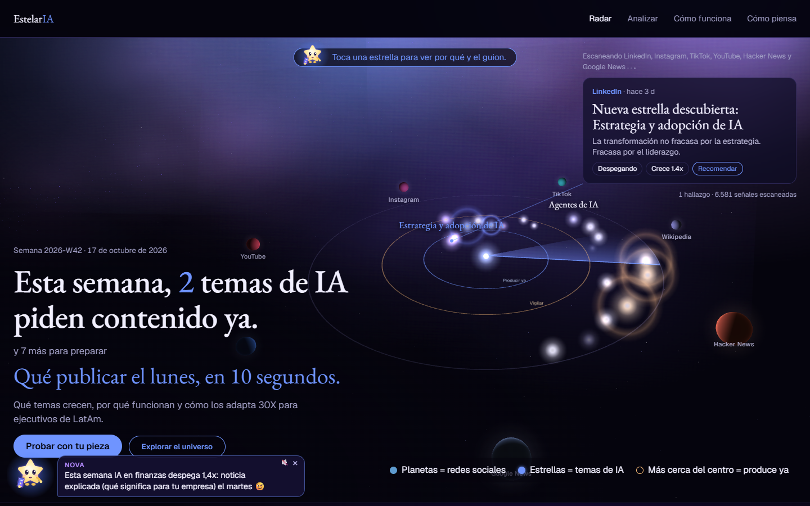

# RadarIA

> Radar + IA: si un tema de IA se está moviendo, RadarIA lo ve venir antes de que todos lo copien.

**Qué temas de IA están despegando en redes, por qué funcionan y cómo los adapta 30X para ejecutivos de LatAm.**
Hackathon 30X · reto *Radar de contenido*.

- Demo: https://p1p2gamer26.pythonanywhere.com/
- Video (3 min): se agrega con la entrega



## El problema
El equipo de media de 30X paga scraping (miles de USD al año) que solo trae datos. No dice **por qué** funcionó una pieza, si una tendencia **recién empieza o ya todos la copiaron**, ni si **le sirve a su audiencia**.

## Qué hace
Cada semana responde: *¿cuáles son los 10 temas de IA que más crecen, por qué y cómo los adaptamos?*

1. **Recolecta** señales públicas sin login: Hacker News (Algolia), Google News (es-419 y en), canales públicos de YouTube por RSS (incluidos los de 30X), páginas vistas de Wikipedia posts públicos de LinkedIn indexados en Google News, y posts/reels públicos de Instagram y TikTok (30X, Andrés Bilbao y hashtags de IA) vía Apify.
2. **Etiqueta** una muestra con un LLM "profesor" barato: tema, formato, gancho, tipo de autor y si le sirve a un ejecutivo.
3. **Entrena un modelo propio** (Naive Bayes en Python puro, `radar/student.py`) con esas etiquetas. Clasifica todo lo demás a **costo cero** y corre en el servidor gratuito.
4. **Mide crecimiento y etapa** por tema (`radar/trend.py`): crecimiento frente a su base, z-score y etapa (`temprana`, `creciendo`, `saturada`, `bajando`, `estable`). Así contesta si el tema recién empieza o ya todos lo copiaron.
5. **Decide** con umbrales trazables (`decision/decide.py`): `Recomendar` (≥ 0.80), `Aprender` (≥ 0.50) o `Descartar`. El motivo cita los números.
6. **Explica y adapta**: formato y gancho ganadores, mejor día y un guion corto para 30X (gancho de 3 s, beats, CTA).
7. **La comunidad como sensor**: en `/analizar` cualquiera pega una pieza pública de Instagram, TikTok o LinkedIn y el radar la clasifica al instante (escáner). Sirve para piezas que el equipo ve en su día a día y aún no están en el radar.

## Resultados

Corrida del 17-oct-2026 (datos en `data/`, reproducible sin red):

- **Señales:** 5.718 (Hacker News 3.240, Google News 2.018, LinkedIn 180, Instagram 127, YouTube 108, TikTok 45) más Wikipedia para 20 temas.
- **Temas:** 20 analizados; 2 Recomendar (ambos Despegando), 8 Aprender, 10 Descartar. Un tema Estable o en su pico nunca pasa de Aprender.
- **Guiones:** 20 de 20 temas con guion LinkedIn/YouTube generado por LLM; 10 con reel IG/TikTok (los Recomendar y Aprender).
- **Costo:** USD 0.55 por semana (Apify, Instagram y TikTok; medido en la consola de Apify el 17-oct, y cada corrida nueva lo mide con la API de uso de Apify en `meta.apify_cost_usd` del snapshot) y USD 0.81 una sola vez por etiquetar 1.226 señales con el LLM (USD 0.000141 por señal).
- **Modelo propio, prueba honesta (hold-out):** se aparta un 20 % fijo de las etiquetas (por hash del id, 234 piezas) que ni el entrenamiento ni la elección del método ven. El método por tarea (Naive Bayes, kNN o ensamble) se elige con validación cruzada de 5 pliegues solo sobre el 80 % restante; la cifra que se reporta es el acierto en el hold-out:

| Tarea | Base del hold-out (clase más común) | Acierto en hold-out | Método | CV sobre el 80 % |
|---|---|---|---|---|
| Tema | 28% | **61%** | ensamble | 60% |
| Formato | 46% | **52%** | ensamble | 62% |
| Gancho | 22% | **35%** | ensamble | 39% |
| Encaje (alto/bajo) | 86% | 85% | NB | no usable: no supera la base por 3 puntos |

  El objetivo de 65% en tema no se alcanzó (61%); las etiquetas del LLM tienen ruido y la clase "otro" pesa casi 30%. El formato casi no mejora la base en el hold-out: la validación cruzada era optimista (62%).
- **Benchmark 30X, mejor pieza:** un post de Instagram de @crece30x con 20x sus likes normales (541 likes reales). IG/TikTok sin vistas se miden con likes.
- **Privacidad:** de terceros solo se guardan título y métricas; hay un test y un chequeo en `verify.sh` que fallan si una url del radar trae un handle (`/@usuario`).

## Costo
Lo que cuesta cada corrida (por señal, profesor y estudiante) se ve en la home y en `data/radar.json` → `totals`. El estudiante clasifica gratis; solo la muestra del profesor tiene costo. La alternativa paga de referencia es de ~USD 3.000 al año (Apify, Exolyt, Sprout); las fuentes están en la página `/como-funciona/`.

## Cómo correrlo
```bash
python -m venv .venv && .venv/Scripts/activate   # Linux/Mac: source .venv/bin/activate
pip install -r requirements.txt
set DJANGO_DEBUG=1                               # Linux/Mac: export DJANGO_DEBUG=1
python manage.py migrate
python manage.py runserver                       # http://127.0.0.1:8000
bash verify.sh                                   # tests + contrato de radar.json + sin datos personales
```
La demo corre **sin red**: lee `data/radar.json`, `data/student.json` y los snapshots versionados en `data/`.

Para actualizar los datos (con red):
```bash
python manage.py collect          # fuentes públicas -> data/snapshots/
python manage.py label            # profesor LLM (OpenAI-compatible, variables en .env.example)
python manage.py train_student    # modelo propio -> data/student.json
python manage.py build_radar      # -> data/radar.json
```
`.github/workflows/radar.yml` lo hace solo cada día a las 6:00 (Bogotá) con el estudiante, gratis.

## Estructura
| Ruta | Qué es |
|---|---|
| `radar/sources.py` | recolectores (HN, Google News, YouTube RSS, Wikipedia) |
| `radar/taxonomy.py` | temas, formatos, ganchos y tipos de autor |
| `radar/label.py` | profesor LLM con validación estricta del JSON |
| `radar/student.py` | modelo propio Naive Bayes (stdlib) |
| `radar/trend.py` | crecimiento, z-score y etapa |
| `radar/build.py` | arma `data/radar.json` (contrato en `SPEC.md`) |
| `decision/decide.py` | motor de decisión con umbrales, regla de respaldo y registro |
| `radar/templates`, `radar/static` | web: escena 3D (Three.js) con los temas como estrellas sobre un radar |
| `deploy/` | despliegue en PythonAnywhere |

## Reglas que cumple
- Solo contenido público y sin login propio: Hacker News, Google News, YouTube y Wikipedia se leen por APIs o feeds públicos; Instagram y TikTok, por scraping de contenido público vía Apify (autorizado por la organización, plan gratis, ~USD 0.55 por semana), sin login y sin guardar usuarios ni texto de terceros; LinkedIn, por titulares públicos indexados en Google News. Nunca iniciamos sesión en esas redes.
- Sin datos personales: los autores se guardan solo como tipo (medio, creador, empresa, comunidad, academia).
- Sin secretos en el repo. `verify.sh` revisa que `radar.json` y `data/snapshots/*.json` no tengan emails ni handles de terceros (las URL con forma de email, como los message-id de listas de correo, se descartan al recolectar).

## Licencia
MIT
