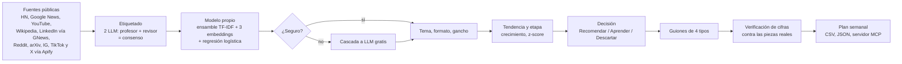

<div align="center">


# EstelarIA

**Detecta qué temas de IA están despegando en redes, por qué funcionan y cómo adaptarlos para ejecutivos de LatAm, por centavos en lugar de miles de dólares al año.**

[](https://github.com/P1p2gamer26/radar-30x/actions/workflows/tests.yml)
[](LICENSE)
[](requirements.txt)
[](https://p1p2gamer26.pythonanywhere.com/)

</div>

Estelar + IA: encuentra las estrellas nacientes del contenido de IA (los temas que recién empiezan a brillar) antes de que todos las copien. Hackathon 30X, reto *Radar de contenido*.

## Demo en 30 segundos
1. Abre la demo: https://p1p2gamer26.pythonanywhere.com/ y toca una estrella (un tema): verás su etapa, por qué funciona y sus guiones.
2. Pega una pieza pública de Instagram, TikTok o LinkedIn en [`/analizar/`](https://p1p2gamer26.pythonanywhere.com/analizar/) y el escáner la clasifica al instante.
3. Mira el pipeline con cifras reales en [`/en-vivo/`](https://p1p2gamer26.pythonanywhere.com/en-vivo/) ("Cómo piensa EstelarIA").
4. Video (3 min): VIDEO_URL <!-- TODO(autor): reemplazar VIDEO_URL por el enlace del video antes de entregar -->

## El problema y las 3 preguntas del brief
El equipo de media de 30X paga scraping («miles de USD al año», brief oficial) que solo trae datos. Cada semana, EstelarIA responde las tres preguntas del reto:

| Pregunta del brief | Cómo la contesta EstelarIA |
|---|---|
| ¿**Por qué** funcionó una pieza? | Por tema muestra formato y gancho ganadores, mejor día y la mejor pieza de cada fuente como evidencia (`why`, `top_signals` en `data/radar.json`). Además, un análisis de piezas atípicas (las que rinden al menos 3x la mediana de su fuente) compara su gancho, formato, día y autor contra el resto (`radar/atipicos.py`). |
| ¿La tendencia **recién empieza** o ya todos la copiaron? | `radar/trend.py` mide crecimiento frente a su base, z-score y etapa (`temprana`, `creciendo`, `saturada`, `bajando`, `estable`). `decision/decide.py` decide con umbrales trazables: `Recomendar` (≥ 0,80), `Aprender` (≥ 0,50) o `Descartar`, y el motivo cita los números. |
| ¿**Le sirve** a la audiencia de 30X? | Un puntaje de encaje ejecutivo por tema (con afinidad a 30X) entra en la decisión; además hay 4 guiones por tema (reel, video largo, LinkedIn, recomendación) y un escáner que adapta una pieza ajena a "Tu versión". |

## Arquitectura

Cada etapa tiene su archivo: `radar/sources.py`, `radar/label.py`, `radar/student.py`, `radar/trend.py`, `decision/decide.py`, `radar/build.py` (arma `data/radar.json`, contrato en `SPEC.md`), `radar/verificar.py`, `radar/plan.py`.

### Qué hace
1. **Recolecta** señales públicas sin login: Hacker News (Algolia), Google News (es-419 y en), canales públicos de YouTube por RSS (incluidos los de 30X), páginas vistas de Wikipedia, Reddit (RSS público de subreddits de IA y negocio, sin votos), arXiv (API Atom, papers recientes de IA), titulares de LinkedIn indexados en Google News, y posts/reels públicos de Instagram y TikTok (30X, Andrés Bilbao y hashtags de IA) y tweets públicos de X con búsquedas de IA (es/en, mínimo 20 likes) vía Apify.
2. **Etiqueta** una muestra con un LLM "profesor" barato: tema, formato, gancho, tipo de autor y si le sirve a un ejecutivo.
3. **Entrena un modelo propio** (`radar/student.py`) con las etiquetas donde un segundo LLM coincide con el profesor (consenso, `python manage.py review_labels`). Offline: un ensamble (TF-IDF + tres modelos de embeddings multilingües: `multilingual-e5-base`, `bge-m3` y `paraphrase-multilingual-mpnet`, cada uno con regresión logística, probabilidades promediadas) clasifica el corpus al armar `radar.json`; el ensamble lo eligió la validación cruzada (tema 71,9 % → 78,6 % en CV) frente a 6 modelos de embeddings y sus combinaciones (`ml/experimento_modelo.py`). En el servidor: regresión logística sobre TF-IDF exportada a JSON e inferida en Python puro (NB/kNN de respaldo), a **costo cero**.
4. **Mide crecimiento y etapa** por tema y **decide** con umbrales trazables.
5. **Explica y adapta**: formato y gancho ganadores, mejor día y 4 guiones por tema (gancho de 3 s, beats, CTA).
6. **Verifica las cifras de los guiones** (`radar/verificar.py`, sin LLM): cada porcentaje, monto, múltiplo o año debe aparecer en las piezas reales del tema. En la corrida actual, 59 de 64 cifras quedaron verificadas (`data/verificacion.json`).
7. **La comunidad como sensor**: en `/analizar/` cualquiera pega una pieza pública y el radar la clasifica al instante.

## Resultados

<!-- RESULTADOS -->
Corrida 2026-W42 (generada 2026-10-17; datos en `data/`, reproducible sin red). Generado por `python manage.py readme_resultados`.

- **Señales:** 6.581 (Hacker News 3.240, Google News 2.018, X (vía Apify) 385, arXiv 300, LinkedIn (vía Google News) 180, Reddit 178, Instagram (vía Apify) 127, YouTube 108, TikTok (vía Apify) 45; más páginas vistas de 20 artículos de Wikipedia como termómetro de interés).
- **Temas:** 20 analizados; 0 Recomendar (ninguno), 8 Aprender, 12 Descartar.
- **Costo:** USD 0.55 por semana (scraping de Instagram/TikTok vía Apify) y USD 0.81 una sola vez por etiquetar 5.687 señales con el LLM (USD 0.000123 por señal); el estudiante clasifica a USD 0.00.
- **Modelo propio, tema** (hold-out fijo del 20 %, 153 piezas con consenso de tema): top-1 **87 %**, top-3 99 %, cuando está seguro acierta 91 % y cubre el 82 % de las piezas; contra todas las etiquetas (incluidas las dudosas) 71 %; adivinar da 25 %.

| Tarea | Top-1 | Top-3 | Cuando está seguro (cobertura) | Contra todas | Base |
|---|---|---|---|---|---|
| Tema (radar, offline) | 87 % | 99 % | 91 % (82 %) | 71 % | 25 % |
| Formato (radar, offline) | 85 % | 98 % | 91 % (82 %) | 70 % | 53 % |
| Gancho (radar, offline) | 79 % | 92 % | 92 % (60 %) | 62 % | 16 % |
| Tema (escáner, servidor) | 76 % | 97 % | 93 % (37 %) | 63 % | 25 % |
<!-- /RESULTADOS -->

**Afinado en Hugging Face (probado, no adoptado):** `ml/train_hf.py` (y `ml/estelaria_finetune.ipynb` para Kaggle/Colab) afina `paraphrase-multilingual-MiniLM-L12-v2` con las ~4.200 etiquetas de consenso: en el mismo hold-out da tema 76 % top-1, 88 % top-3, 92 % seguro (58 % de cobertura). El ensamble de embeddings congelados + regresión logística (arriba) gana con 87 / 99 / 91 % (cobertura 82 %), así que queda como modelo del radar; el afinado queda como alternativa reproducible (`python manage.py push_model_hf` lo sube al Hub con `HF_TOKEN`). Resultados en `data/hf_eval_topic.json`.

**Nuestro modelo propio vs un LLM grande gratis** (mismo hold-out de tema, 153 piezas, etiqueta = consenso de dos LLM; `python manage.py llm_vs_student`): `deepseek-v4.1-flash-free` por el CLI de OpenCode Zen acierta 87 % (0 sin parsear, ~0,68 s por pieza, USD 0 pero con límite de uso y sin garantía de servicio); nuestro estudiante acierta lo mismo, 87 % (~0,0002 s por pieza, USD 0, sin depender de un servicio externo). Con el modelo anterior (un solo embedding) el estudiante acertaba 80 %. **Cascada ('Jev abierto')**: si el estudiante está seguro (umbral τ = 0,58 elegido en validación cruzada, no en este hold-out) responde él; si no, escala al LLM. Resultado: **89,5 %** de acierto (más que el LLM solo, 86,9 %), resolviendo al instante el 82 % de las piezas y llamando al LLM solo en 28 de 153 (antes 60). Las respuestas del LLM son las mismas guardadas (`llm_vs_student --reusar`); solo cambió el estudiante.

**Jev (modelo aliado del reto):** lo intentamos el 18-oct por OpenCode Zen (`jev-1.13-free`): la API pública de Zen solo permite el plan gratis desde la app OpenCode y el cliente `opencode run` no habla el protocolo de Jev (System One), así que no pudimos medirlo a tiempo. Nuestro modelo propio clasifica a USD 0 por pieza y acierta 80 % en el hold-out; comparar Jev en ese mismo hold-out es el siguiente paso.

**Backtest (indicativo):** `python manage.py backtest` corta los datos en el día 7 y compara lo marcado como "empezando" con lo que creció en los días 8-14 (`data/backtest.json`). El radar acierta 2 de 6 marcados (precisión 0,33); ordenar por popularidad acierta 0 de 6; la base al azar es 0,30. Es una sola semana y 6 marcados: una señal, no una prueba.

## Integraciones: sacar el plan de la semana
El plan (temas Recomendar + Aprender con etapa, por qué, guion, reel y plataforma) sale en dos formatos, siempre desde `data/radar.json`:

- `GET /api/semana.csv`: descarga el CSV (también el botón "Descargar plan (CSV)" de la home).
- `GET /api/semana.json`: lo mismo en JSON (`{"week": ..., "temas": [...]}`).
- Botón "Copiar para WhatsApp/Slack" en la home: resumen corto en texto.

**Notion o Google Sheets:** descarga el CSV e impórtalo (Notion: Importar > CSV; Sheets: Archivo > Importar). Para que se actualice solo en Sheets: `=IMPORTDATA("https://p1p2gamer26.pythonanywhere.com/api/semana.csv")`.
El CSV y el JSON traen `dia_sugerido` (mejor día de publicación del tema) y `responsable` (vacía, para que el equipo la llene).

**Servidor MCP (Claude Desktop / Claude Code):** `mcp_radar.py` expone el radar como herramientas `top_temas`, `tema` y `analizar` (stdio, solo stdlib, sin red).
Claude Code: `claude mcp add estelaria -- python mcp_radar.py` (desde la raíz del repo). Claude Desktop, en `claude_desktop_config.json`:
`{"mcpServers": {"estelaria": {"command": "python", "args": ["C:/ruta/radar-30x/mcp_radar.py"]}}}`

**Webhook (Slack, Make, Zapier, n8n):** un cron semanal que haga GET al JSON y lo reenvíe, por ejemplo cada lunes 7:00:
```bash
0 7 * * 1  curl -s https://TU-DOMINIO/api/semana.json | curl -s -X POST -H "Content-Type: application/json" -d @- "$WEBHOOK_URL"
```

## Costos
Solo cifras medidas:

| Concepto | Costo |
|---|---|
| Scraping de Instagram y TikTok (Apify, plan gratis) | USD 0,55 por semana ≈ USD 29 al año (medido en la consola de Apify, 17-oct) |
| Etiquetado con LLM de 5.687 señales | USD 0,81, una sola vez |
| Guiones con LLM | ~USD 0,27, una sola vez |
| Modelo propio, hosting (PythonAnywhere free), fuentes públicas | USD 0 |

**Alternativa de pago, ~USD 3.000 al año** (referencia conservadora). Fuentes: el brief oficial habla de «miles de USD al año»; Apify Scale cuesta USD 199 al mes = USD 2.388 al año; Brandwatch no publica precio y su mediana estimada según compras reportadas en Vendr es ~USD 50.000 al año (estimado, no medido).

### Si 30X sigue 50 cuentas
Supuesto: 20 publicaciones por cuenta y por red (Instagram y TikTok) por semana = 2.000 resultados. Precios públicos por resultado de los actores de Apify (consultados en `GET /v2/acts/<id>`, plan gratis): `apify~instagram-scraper` USD 0,0027 y `clockworks~tiktok-scraper` USD 0,0037. El etiquetado con IA (USD 0,81) es de una sola vez.

| Escenario | Por semana | Por año | Frente a USD 3.000/año |
|---|---|---|---|
| Hoy: ~170 resultados (medido) | USD 0,55 | USD 28,60 | 1 % |
| 50 cuentas, precio público de Apify | USD 6,40 | USD 332,80 | 11 % |
| 50 cuentas, tasa medida (0,55 / 170 resultados) | USD 6,47 | USD 336,47 | 11 % |

## Instalación y uso
```bash
python -m venv .venv && source .venv/bin/activate   # Windows: .venv\Scripts\activate
pip install -r requirements.txt
cp .env.example .env                                # solo nombres; pon tus valores si vas a actualizar datos
export DJANGO_DEBUG=1 DECISION_MODE=replay          # Windows: set VAR=valor
python manage.py migrate
python manage.py runserver                          # http://127.0.0.1:8000
bash verify.sh                                      # pruebas + contrato de radar.json + sin datos personales
```
La demo corre **sin red**: lee `data/radar.json`, `data/student.json` y los snapshots versionados en `data/`. Pruebas: `DECISION_MODE=replay python -m pytest -q`.

Para actualizar los datos (con red y claves en `.env`):
```bash
python manage.py collect            # fuentes públicas -> data/snapshots/
python manage.py label              # profesor LLM (OpenAI-compatible)
python manage.py review_labels      # segundo LLM -> marca de consenso
python manage.py train_student      # modelo propio -> data/student.json
python manage.py build_radar        # -> data/radar.json
python manage.py backtest           # corte día 7 vs días 8-14
python manage.py llm_vs_student     # estudiante vs LLM grande en el hold-out
python manage.py adapt --guiones    # guiones de 4 tipos por tema
python manage.py oportunidades_red  # oportunidades por red
python manage.py readme_resultados  # reescribe el bloque Resultados de este README
```
`.github/workflows/radar.yml` recolecta y reconstruye cada día a las 6:00 (Bogotá) con el estudiante, gratis. `.github/workflows/tests.yml` corre `pytest` en cada push. El servidor MCP está descrito en Integraciones.

## Estructura del repo
| Ruta | Qué es |
|---|---|
| `config/` | settings, urls y wsgi de Django |
| `radar/` | app principal: fuentes, etiquetado, modelo propio, tendencia, guiones, vistas |
| `radar/atipicos.py`, `radar/verificar.py`, `radar/en_vivo.py` | piezas atípicas, verificación de cifras, página `/en-vivo/` |
| `radar/management/commands/` | comandos `collect`, `label`, `train_student`, `build_radar`, `backtest`, etc. |
| `radar/templates`, `radar/static` | web: escena 3D (Three.js) con los temas como estrellas |
| `decision/` | motor de decisión con umbrales, regla de respaldo y registro record/replay |
| `data/` | snapshots, etiquetas, `student.json`, `radar.json` y evaluaciones (fuente de todas las cifras) |
| `ml/` | afinado en Hugging Face (`train_hf.py`, notebook para Kaggle/Colab) |
| `mcp_radar.py` | servidor MCP por stdio, solo stdlib |
| `tests/`, `verify.sh` | pruebas sin red y verificador de contrato |
| `deploy/` | despliegue en PythonAnywhere |
| `.github/` | workflows, plantillas de issue y PR |
| `SPEC.md`, `AGENTS.md` | contrato de datos y reglas de código |

## Privacidad y ética
- Solo contenido público y sin login propio. Hacker News, Google News, YouTube y Wikipedia se leen por APIs o feeds públicos. Instagram y TikTok, por scraping de contenido público vía Apify (autorizado por la organización del hackathon, plan gratis), sin guardar usuarios ni texto de terceros. LinkedIn, solo por titulares públicos indexados en Google News. Nunca iniciamos sesión en esas redes.
- Sin datos personales: los autores se guardan solo como tipo (medio, creador, empresa, comunidad, academia). `verify.sh` revisa que `radar.json` y `data/snapshots/*.json` no tengan emails ni handles de terceros.
- Seguridad web: autoescape de Django, `textContent` en el front para datos externos, CSRF activo, límite por IP en `/analizar/`.
- Sin secretos en el repo; ver [SECURITY.md](SECURITY.md).

## Limitaciones honestas
- **Una semana de datos** (2026-W42): crecimiento y etapas salen de una ventana de 14 días.
- **Hold-out de 234 piezas** (153 en la comparación con el LLM): las cifras de acierto tienen un margen de error amplio.
- **LinkedIn solo por titulares** de Google News, sin métricas de interacción.
- **Backtest indicativo**: 6 temas marcados y una sola semana; no mide anticipación en días.
- **Jev no medido**: no tuvimos acceso a tiempo.
- La cascada a un LLM gratis depende de límites de uso y no tiene garantía de servicio.

## Roadmap
- Acumular varias semanas de datos y repetir el backtest con más temas.
- Medir Jev en el mismo hold-out.
- Ampliar a más cuentas de 30X (costo estimado arriba).
- Más fuentes con métricas de interacción para LinkedIn.

## Créditos y licencia
Hecho por **Julián Africano**, estudiante de Ingeniería de Sistemas, Pontificia Universidad Javeriana, para el Hackathon 30X. Licencia [MIT](LICENSE).

---

## English summary
EstelarIA is a Django app that tracks which AI topics are taking off on social media, explains why they work, estimates their stage (early, growing, saturated) and adapts them into scripts for 30X's LatAm executive audience. It collects 6,196 public signals from 9 sources (Hacker News, Google News, arXiv, LinkedIn headlines via Google News, Reddit, Instagram/TikTok via Apify, YouTube, plus Wikipedia pageviews), labels them once with two LLMs (4,176 consensus labels), and trains its own model: an ensemble of TF-IDF and three multilingual embeddings (e5-base, bge-m3, mpnet) with logistic regression, chosen by cross-validation. On a fixed topic hold-out (153 pieces, never seen) it scores 87 % top-1 / 99 % top-3, matching a large free LLM (DeepSeek, 86.9 %) at zero cost; a cascade that asks the LLM only when unsure reaches 89.5 % while calling it on 28 of 153 pieces. Measured cost: about USD 0.55/week for scraping plus USD 0.81 one-time labeling, versus roughly USD 3,000/year for paid alternatives. Run it offline with `pip install -r requirements.txt && DJANGO_DEBUG=1 python manage.py runserver`; tests with `python -m pytest -q`. Limitations: two weeks of data, indicative backtest, Jev (paid) replaced by an open System One model measured honestly.
